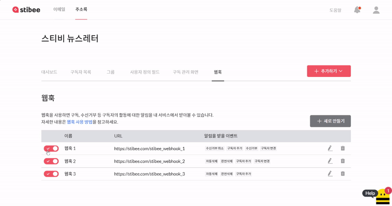

---
layout:
  width: default
  title:
    visible: true
  description:
    visible: false
  tableOfContents:
    visible: true
  outline:
    visible: true
  pagination:
    visible: true
  metadata:
    visible: true
  tags:
    visible: true
  actions:
    visible: true
  anchors:
    visible: true
---

# 웹훅 사용하기

💬 이 내용은 **스탠다드, 프로, 엔터프라이즈 요금제**에 해당하는 도움말입니다.

## 이 글에서는

주소록 웹훅을 활용해서 스티비 주소록에서 이벤트가 발생했을 때 사용자의 서버로 알림 받는 방법을 알아봅니다.

***

## 주소록 웹훅 이해하기

주소록 웹훅을 사용하면 주소록에서 이벤트가 발생했을 때 사용자의 서버로 알림을 받을 수 있습니다. 사용자는 어떤 URL로 알림을 받을지, 어떤 내용의 알림을 받을지 설정할 수 있습니다. [주소록 API](api.md)와 함께 사용하면 내 서비스의 회원 정보와 스티비 주소록을 완전히 동기화할 수 있습니다.

알림은 POST Method를 사용하여 JSON 형태로 전달됩니다. 웹훅은 주소록 단위로 관리되며, 하나의 주소록은 여러 개의 웹훅을 가질 수 있습니다.


## 웹훅 사용하기 <a href="#id-1" id="id-1"></a>

웹훅은 주소록 단위로 관리되기 때문에 \[주소록 → 웹훅]에서 웹훅을 관리할 수 있습니다. 여기에서 새로운 웹훅을 만들 수 있으며, 만들어진 웹훅을 확인하거나 활성화, 비활성화, 수정, 삭제할 수 있습니다.

### 웹훅 만들기 <a href="#id-1-api" id="id-1-api"></a>

웹훅을 사용하려면 우선 스티비에서 웹훅을 만들어야 합니다. \[주소록 → 웹훅 → 새로 만들기]를 눌러 새로운 웹훅을 만듭니다.&#x20;

새로운 웹훅을 만들기 위해 아래 정보가 필요합니다.

* 이름: 웹훅을 관리하기 위한 이름을 입력합니다. 같은 주소록 안에서 이미 쓰고 있는 이름은 쓸 수 없습니다.
* URL: 이벤트 알림을 받을 URL을 입력합니다.
  * https://로 시작하는 도메인 주소만 입력할 수 있으며, 같은 주소록 안에서 이미 등록된 URL은 쓸 수 없습니다. 자세한 조건은 웹훅 정책에서 확인해 주세요.
* 알림을 받을 이벤트: 알림을 받을 이벤트를 선택합니다. 복수 선택할 수 있습니다.


웹훅에는 별도의 인증 과정이 없기 때문에, 인증이 필요한 경우 스티비의 웹훅 서버의 IP 주소로 인증 처리를 해야 합니다. 스티비 웹훅 서버 IP 주소는 52.78.132.66입니다.


<figure><figcaption></figcaption></figure>


## 웹훅 정책 <a href="#policy" id="policy"></a>


2026년 11월 30일부터 적용되는 조건입니다. 이전에 만든 웹훅에도 똑같이 적용되므로, http:// 주소나 IP 주소를 사용 중이라면 https:// 도메인 주소로 수정해 주세요.


웹훅 정책은 웹훅 URL로 쓸 수 있는 주소와, 전송에 실패했을 때 처리 기준을 정한 것입니다.

### 웹훅 URL 조건

웹훅 URL은 'https://'로 시작하는 도메인 주소만 사용할 수 있습니다. 아래 주소는 사용할 수 없습니다.

* http://로 시작하는 주소
* localhost
* IP 주소 (예: https://123.123.123.123)
* 도메인이 내부망 주소로 연결되는 주소

URL 조건은 웹훅을 만들거나 수정, 활성화할 때 확인합니다. 조건에 맞지 않으면 '잘못된 URL입니다' 안내 문구가 표시되고 웹훅이 저장되지 않습니다. 웹훅을 전송할 때도 매번 다시 확인합니다.

### 웹훅 전송 실패와 재시도

웹훅 전송은 사용자의 서버가 2xx 응답(200, 201 등 성공을 뜻하는 응답)을 보내면 성공으로 처리합니다. 아래 경우는 전송 실패로 처리합니다.

* 15초 안에 응답이 없는 경우
* 서버에 연결되지 않는 경우
* 3xx(리다이렉트), 4xx, 5xx 응답을 받은 경우

전송에 실패하면 10분 간격으로 최대 5회 다시 시도합니다. 첫 전송을 포함해 약 1시간 동안 최대 6회 시도하며, 모두 실패한 이벤트는 더 이상 보내지 않습니다.

### 웹훅 자동 비활성화

아래 경우 웹훅이 자동으로 비활성화됩니다.

* 웹훅을 전송할 때 URL이 ‘[웹훅 URL 조건](https://help.stibee.com/~/changes/462/api-webhook/list-webhook#url)’에 맞지 않으면 바로 비활성화됩니다.
* 첫 전송 실패 후 5일(120시간)이 지난 시점에 다시 전송에 실패하면 비활성화됩니다. 단, 중간에 한 번이라도 전송에 성공하거나 웹훅을 수정하면 기준이 처음부터 다시 시작됩니다.

웹훅이 자동으로 비활성화되면 안내 이메일을 보내드립니다. 다시 사용하려면 \[주소록 → 웹훅]에서 URL을 확인하고 수정한 뒤 활성화해 주세요.


## 이벤트 종류 <a href="#id-2" id="id-2"></a>

웹훅에서 알림 받을 수 있는 이벤트의 종류는 다음과 같습니다.

* 구독: 주소록에 구독자가 추가됐습니다.
* 구독자 정보 변경: 구독자의 정보(이름 등)가 변경됐습니다.
* 수신거부: 구독자가 수신거부 상태로 변경됐습니다.
* 수신거부 취소: 구독자의 수신거부가 취소됐습니다.
* 자동 삭제: 구독자가 자동 삭제 상태로 변경됐습니다.
* 완전삭제: 구독자가 완전 삭제됐습니다.

모든 이벤트는 관리자 또는 API를 통해 발생하거나 구독자에 의해 발생했을 수 있습니다. 이에 대한 정보는 별도의 String으로 전달됩니다.


## 이벤트 모델 <a href="#id-3" id="id-3"></a>

웹훅 알림은 POST Method를 사용하여 JSON 형식으로 전달됩니다. 전달되는 이벤트 모델의 기본 구조는 다음과 같습니다.

_\* 웹훅 전송에 실패하면 10분 간격으로 최대 5회 다시 시도합니다 자세한 내용은_ [_웹훅 정책_](list-webhook.md#policy)_에서 확인해 주세요._

### id <a href="#id" id="id"></a>

주소록의 고유 아이디입니다.

### action <a href="#action" id="action"></a>

발생한 이벤트의 종류입니다.

* "SUBSCRIBED": 구독
* "UPDATED": 구독자 정보 변경
* “UNSUBSCRIBED”: 수신거부
* “RESUBSCRIBED”: 수신거부 취소
* “DELETED”: 자동 삭제
* “PURGED”: 완전삭제

### eventOccurredBy <a href="#eventoccurredby" id="eventoccurredby"></a>

이벤트를 발생시킨 주체입니다.

* “MANUAL”: 관리자 또는 API에 의해 발생
* “SUBSCRIBER”: 구독자에 의해 발생

### subscribers <a href="#subscribers" id="subscribers"></a>

구독자 정보를 담고 있습니다. Key-Value 배열 형식으로 구성됩니다. 주소록의 [사용자 정의 필드](../list/adding-managing-subscriber/understanding-subscriber-info.md#h_01gw45zrwcjd1eg1cam4vhw25m)에 정의된 내용을 참조합니다. 이벤트 종류에 따라 추가 정보를 표시합니다.

* Key: 사용자 정의 필드의 “태그”(email, name 등)
* Value: Key에 해당하는 값. 구독, 구독자 정보 변경 이벤트 발생 시에만 \[사용자 정의 필드]에 정의된 내용이 포함되며, 나머지 이벤트에 대해서는 “email” 값만 표시됩니다.

이벤트 종류에 따라 아래 정보가 추가됩니다.

* "UPDATED"(구독자 정보 변경): "old\_email": "구독자가 변경 전 사용하던 이메일 주소"
* “UNSUBSCRIBED”(수신거부): "$unsubscribe\_reason": "구독자가 수신거부 화면에서 입력한 수신거부 사유"&#x20;

단, \[사용자 정의 필드]에 "old\_email"이라는 키 값을 사용하는 필드가 있다면, 이전에 사용하던 이메일 주소가 아닌 사용자 정의 필드의 값이 표시됩니다. (old\_email 값이 제대로 표시되기 위해 사용자 정의 필드에 old\_email 키 값의 필드가 있다면 키 값을 수정해 주세요.)


## 이벤트 예제

구독자가 구독 신청 양식을 통해 직접 구독한 경우, 다음과 같은 이벤트 알림이 전달됩니다.

```json
{
    "id":"4617",
    "action":"SUBSCRIBED",
    "eventOccurredBy":"SUBSCRIBER",
    "subscribers": [
        {"email":"gildong@stibee.com", "name":"길동"}
    ]
}
```

\
구독자가 수신 거부한 경우, 다음과 같은 이벤트 알림이 전달됩니다.

```json
{
    "id":"4617",
    "action":"UNSUBSCRIBED",
    "eventOccurredBy":"SUBSCRIBER",
    "subscribers": [
        {"email":"gildong@stibee.com", "$unsubscribe_reason": "수신거부 사유"} 
    ]
}
```

\
스티비에서 관리자가 여러명의 구독자를 한 번에 추가한 경우, 다음과 같은 이벤트 알림이 전달됩니다.

```json
{
    "id":"4617",
    "action":"SUBSCRIBED",
    "eventOccurredBy":"MANUAL",
    "subscribers": [
        {"email":"gildong@stibee.com", "name":"길동"},
        {"email":"dooly@stibee.com", "name":"둘리"},
        {"email":"doner@stibee.com", "name":"도우너"}
    ]
}
```

&#x20;

구독자가 정보를 직접 변경한 경우, 다음과 같은 이벤트 알림이 전달됩니다.

```json
{
    "id":"4617",
    "action":"UPDATED",
    "eventOccurredBy":"SUBSCRIBER",
    "subscribers": [
        {"email":"gildong@stibee.com", "old_email":"gildong@naver.com"}
    ]
}
```

&#x20;

관리자가 구독자의 정보를 변경한 경우, 다음과 같은 이벤트 알림이 전달됩니다.

```json
{
    "id":"4617",
    "action":"UPDATED",
    "eventOccurredBy":"MANUAL",
    "subscribers": [
        {"email":"gildong@stibee.com", "old_email":"gildong@naver.com"}
    ]
}
```
