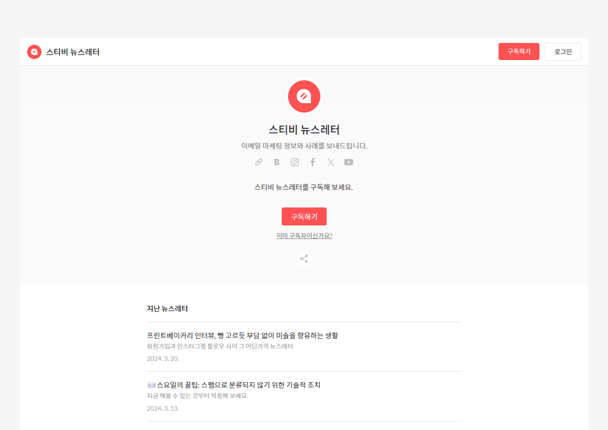

---
layout:
  width: default
  title:
    visible: true
  description:
    visible: false
  tableOfContents:
    visible: true
  outline:
    visible: true
  pagination:
    visible: true
  metadata:
    visible: true
  tags:
    visible: true
  actions:
    visible: true
  anchors:
    visible: true
---

# 개요

## 이 글에서는

스티비 서비스를 활용하기 위한 기본 개념에 대해 알아봅니다.

***

## 스티비 이해하기

회원가입을 마치고 로그인을 하면 메인 대시보드 화면이 표시됩니다. 대시보드 화면 왼쪽에 보이는 4가지 메뉴 버튼을 확인할 수 있습니다. 이 4가지 메뉴는 스티비에서 제공하는 주요 기능의 이름입니다. 어떤 작업을 하고 싶은지에 따라 여기서 필요한 메뉴를 선택해 작업을 진행하면 됩니다.

<figure><figcaption></figcaption></figure>

### 이메일

\[이메일]에서는 뉴스레터, 마케팅 이메일, 트랜잭셔널 이메일 등 이메일 내용을 편집하고 발송할 수 있습니다. 이메일은 크게 두 가지 종류로 나뉩니다.

* [일반 이메일](https://app.gitbook.com/s/eAMHRdY4ATDXfWZWQs3p/email): 한 번에 많은 사람에게 보내는 이메일입니다. 뉴스레터, 광고, 업데이트 소식처럼 정해진 시점에 한 번 발송하는 이메일에 적합합니다.
* [자동 이메일](../email/automation/): 정해진 조건을 만족할 때마다 자동으로 발송되는 이메일입니다. 구독자가 주소록에 추가될 때 보내는 웰컴 이메일, 이메일 안의 특정 링크를 클릭하면 보내는 후속 이메일에 적합합니다.

<figure><figcaption></figcaption></figure>

### 주소록

\[주소록]은 이메일을 받아 볼 수신자를 추가하고 관리할 수 있는 기능입니다. 스티비에서는 이메일을 수신하는 사람을 '구독자'로 표현하고 있고 필요에 따라 구독자를 주소록에 추가해서 보낼 수 있고 구독 신청을 받을 수 있습니다. 주소록은 크게 세 가지 종류로 나뉩니다.

* [일반 주소록](https://app.gitbook.com/s/eAMHRdY4ATDXfWZWQs3p/list): 구독자를 추가하고 관리하는 기본 주소록입니다.
* [유료 주소록](https://app.gitbook.com/s/eAMHRdY4ATDXfWZWQs3p/paid-newsletter): 유료 뉴스레터를 운영할 때 사용하는 주소록입니다. 사전에 승인받은 워크스페이스에서만 생성할 수 있습니다.
* [연동 주소록](https://app.gitbook.com/s/eAMHRdY4ATDXfWZWQs3p/integration): 카페24, NHN커머스, 식스샵 등 외부 솔루션으로 만든 온라인 홈페이지의 회원 정보를 자동으로 불러오는 주소록입니다. 연동된 온라인 홈페이지의 회원 정보를 자동으로 불러옵니다. 스티비와 연동한 외부 솔루션이 있는 경우에만 생성할 수 있습니다.

<figure><figcaption></figcaption></figure>

### 페이지

\[페이지]는 내가 만든 이메일을 웹에 게시하여 홍보하고 구독자를 모을 수 있는 홈페이지를 만들 수 있는 기능입니다. 페이지를 사용하면 만든 이메일을 간단하게 게시하고 게시한 콘텐츠를 활용해 구독자를 모아볼 수 있습니다.&#x20;

* 참고: [스티비 뉴스레터](https://newsletter.stibee.com)

<figure><figcaption></figcaption></figure>

### 통계

💬이 내용은 **프로, 엔터프라이즈 요금제**에 해당하는 도움말입니다.

여러 이메일의 통계를 한 번에 조회하거나 기간별로 조회하고 싶을 때 사용하는 기능입니다.

<figure><figcaption></figcaption></figure>


개별 이메일, 주소록(구독자) 단위 통계는 요금제와 관계없이 확인할 수 있으며, 아래 경로에서 조회할 수 있습니다.

* [개별 이메일](../email/analytics/email-statistics-dashboard.md): 이메일 → 대시보드 또는 상세 통계
* [구독자](../list/check-subscriber-statistics/): 주소록 → 구독자 목록 → 대시보드


## 섹션 살펴보기

이번 섹션에서는 스티비로 이메일을 보내기 위한 기본적인 내용부터 이메일을 문제없이 보내기 위해 첫 발송 전에  미리 준비해야 하는 설정을 안내하고 있습니다. 준비된 단계별로 하나씩 살펴보셔도 좋고, 원하는 내용이 있을 경우 아래 도움말을 클릭해 바로 넘어가서 확인할 수도 있습니다.


[preparing-for-start](preparing-for-start/)



[send-first-email.md](send-first-email.md)



[welcome-email.md](welcome-email.md)



[undefined-4.md](undefined-4.md)

